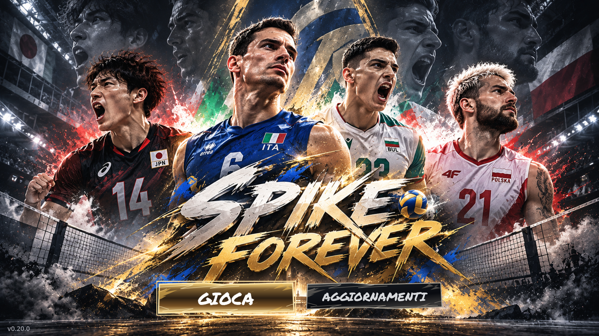

# Spike Forever

**Versione 0.66.0:** Campionato Master League con calendario ufficiale, coppe, salvataggi e UI dedicata. Sostituzioni regolamentari, fatica opzionale, menu Gioca con Esibizione/Online/Campionato. Classifica allineata, sostituzioni a tre passaggi, replay più lunghi e monster block riequilibrati. [Novità e verifiche](docs/RELEASE_NOTES_66.md) · [Audit](docs/CAREER_AUDIT_66.md).

**Versione 0.65.0:** loghi ufficiali dei 12 club, scoreboard televisivo in alto a sinistra, logo SuperLega in alto a destra e replay brevi laterali con transizioni. Fischi variati, attacchi più tesi, muro CPU a tre limitato ai recuperi con alzata alta e terzi tocchi più vari. [Novità](docs/RELEASE_NOTES_65.md) · [Implementazione e verifiche](docs/BROADCAST_REPLAY_65.md).

**Versione 0.64.0:** primo attacco distinto dalla ricezione e dai rigiocati, sei schemi aggiuntivi, continuità di primo tempo/7 e verifica delle seconde palle. [Dettagli e verifiche](docs/FIRST_ATTACK_64.md).

**Versione 0.63.0:** Difesa per tutti i giocatori, radar esagonale e statistiche gameplay opzionali offline/online, con percorso originale conservato. [Dettagli e verifiche](docs/PLAYER_STATS_63.md).

**Versione 0.62.0:** rotazioni P1–P6 ricostruite dai 18 schemi forniti: ricezione, attacco, difesa e corridoi di preparazione. Nuovo fischio dell'arbitro dall'audio allegato. [Dettagli](docs/RELEASE_NOTES_62.md).

Restano le correzioni del [muro della 0.59](docs/RELEASE_NOTES_59.md): contatti pieni sulle mani, salto CPU conservato fino all'atterraggio e press della palla oltre la rete.

Restano le correzioni di [recuperi e preparazione del centrale della 0.57](docs/RELEASE_NOTES_57.md) e tutte le [impostazioni grafiche e di lingua](docs/RELEASE_NOTES_53.md).

La 0.52.0 introduce correzioni delle alzate, difese variabili e muri più incisivi: [dettagli](docs/RELEASE_NOTES_52.md).

Online 6v6: [istruzioni e collegamento tramite codice](docs/RELEASE_NOTES_51.md). Entrambi i giocatori devono aggiornare alla 0.66.0 (protocollo SF066).

**Versione 0.50.0:** rincorsa principale di banda, opposto e pipe con il gesto completo di corsa e schiacciata; apertura e avvio anticipati prima del tocco del palleggiatore. Stacco legale fuori dai tre metri e contatto/atterraggio dentro per la seconda linea. Pipe veloce più bassa e immediata, stessa curva di potenza per tutti gli attacchi. [Dettagli e video](docs/RELEASE_NOTES_50.md).

**Versione 0.49.0:** Formazioni sempre visibili nella preparazione della partita, anteprime delle divise adattive e navigazione con D-pad/levetta sinistra. Fine partita con ritorno automatico alla home dopo l'esultanza; verificati tutti i formati, vantaggi e set decisivi. [Dettagli](docs/RELEASE_NOTES_49.md).

**Versione 0.48.0:** primo tempo con rincorsa, caricamento e stacco anticipati sul contatto del palleggiatore; finta con un vero gesto di schiacciata, senza la posa ferma a due mani. Un solo orologio attraversa alzata e attacco, conservando il pallonetto di polso senza riavviare il salto. [Dettagli e video di verifica](docs/RELEASE_NOTES_48.md).

**Versione 0.47.0:** muro più incisivo e vario, CPU leggermente più pronta a muro, pallonetto sincronizzato con la rincorsa, spostamento del battitore e passo indietro automatico prima del servizio. Nuovi capelli, barbe e carnagioni con 167 profili indicativi dalle foto ufficiali. Priorità del palleggiatore sul secondo tocco. [Dettagli e verifiche](docs/RELEASE_NOTES_47.md).

**Versione 0.46.0:** pali CREDEM, seggiolone sul lato sinistro e arbitro originale animato con gesti contestuali. Centrale preparato sul primo tempo anche come finta, rincorse complete più leggibili e anteprime reali delle divise nel menu partita. [Dettagli e verifiche](docs/RELEASE_NOTES_46.md).

**Versione 0.45.1:** revisione dei marchi delle maglie di Padova, conservando le 32 divise, la stampa dei giocatori e gli abbinamenti del libero introdotti nella v45. [Dettagli](docs/RELEASE_NOTES_45_1.md).

**Versione 0.45.0:** divise delle 12 squadre ricostruite dai riferimenti forniti: 32 varianti casa, trasferta e libero, pantaloncini coordinati, nome e numero stampati sul retro e aggiornati dai dati locali. Libero con divisa opposta quando manca una variante dedicata. [Anteprime, fonti e verifiche](docs/RELEASE_NOTES_45.md).

**Versione 0.44.0:** primo tempo e finta anticipati, corsa e salto in avanzamento anche per pipe e opposto di seconda linea. Muro con contatto continuo sulle mani e risposte diverse tra muro pieno, tocco giocabile e deviazione esterna. Meno ricezioni di la e attacchi CPU ordinari all'82-96,5%. [Dettagli e verifiche](docs/RELEASE_NOTES_44.md).

**Versione 0.43.0:** eliminato il riavvio del bagher dopo un recupero mancato e interrotta la corsa verso il vecchio bersaglio. Centrale preparato prima e palleggiatore piu pronto al secondo tocco, preservando il corridoio del primo tempo. [Dettagli e verifiche](docs/RELEASE_NOTES_43.md).

**Versione 0.42.0:** apertura e rincorsa fisica piu ampia per le palle alte in zona 4 e 2, centrale davanti al palleggiatore e priorita S/L sul secondo tocco. Cache delle gerarchie per ridurre il costo CPU delle pose; pausa con ritorno al menu. [Dettagli e video](docs/RELEASE_NOTES_42.md) · [Prestazioni e verifiche](docs/PERFORMANCE_42.md).

**Versione 0.41.0:** due prototipi ibridi integrati: tuffo frontale con caduta/rialzata e schiacciata con adattamento limitato a busto e spalla. Risorse AnimationTree supplementari e fallback PSA conservato; **F7** confronta i nuovi gesti con gli originali, **F6** alterna il backend. [Come provarli, file e limiti](docs/RELEASE_NOTES_41.md) · [Misure prima/dopo con 12 giocatori](docs/ANIMATION_PERFORMANCE_41.md).

**Versione 0.40.0:** raggruppamento a fine punto con passi e attesa eretti; pilone sul lato dell'attacco posizionato automaticamente, centrale su LS e salto comune su Croce/A. L2/R2 continuano ad avvicinare i laterali. Rincorse anticipate e preparazione della schiacciata più estesa; CPU più precisa, con sette risposte difensive differenti. [Dettagli e verifiche](docs/RELEASE_NOTES_40.md).

**Versione 0.39.0:** atmosfera sonora continua con nuovi sottofondi e ritmi più lunghi, dissolvenze e fischio arbitrale registrato. Esultanze del pubblico solo ai punti della squadra di casa, applausi occasionali anche durante il gioco, nessun riquadro dopo i punti ordinari e colori del campo più scuri. **L3 / LS** mantiene il mute globale. [Dettagli e verifiche](docs/RELEASE_NOTES_39.md).

**Versione 0.38.0:** corridoio del palleggiatore preservato anche cambiando attaccante, attacco automatico al 100% sulle ricezioni avversarie che passano di là, campo crema/blu con marchi CREDEM originali e banner sponsor animati. Pubblico rivisto, 54 varianti sonore da palazzetto e **L3 / LS** per disattivare o riattivare tutto l'audio. [Dettagli e verifiche](docs/RELEASE_NOTES_38.md).

**Versione 0.37.0:** camera TV obliqua come il riferimento, difesa CPU più varia e leggermente meno precisa, battute più rapide e arretramento difensivo lievemente ritardato. [Dettagli](docs/RELEASE_NOTES_37.md).

**Versione 0.36.0:** copertura difensiva condivisa tra laterale libero, libero e seconda linea; corto sui tre metri, diagonale, zona intermedia e parallela assegnati in base a rotazione, attacco e muro effettivo. [Dettagli e verifiche](docs/RELEASE_NOTES_36.md).

**Versione 0.34.0:** rischio progressivo oltre il 100% per attacchi e pallonetti, servizio più incisivo, ricezione con tolleranza intermedia e laterale lontano in copertura sui tre metri. [Dettagli](docs/RELEASE_NOTES_34.md).

**Versione 0.33.0:** ricezione più permissiva, battute più tese senza cambiare la barra, attacchi d'emergenza dopo bagher, recuperi bassi e pallonetto con carica e mira come l'attacco. [Dettagli](docs/RELEASE_NOTES_33.md).

**Versione 0.32.0:** Conferma raggiungibile con controller nella formazione prematch; selettore della rotazione iniziale R1–R6 per entrambe le squadre con schema aggiornato e applicazione in partita. [Dettagli](docs/RELEASE_NOTES_32.md).

**Versione 0.31.0:** annunci con la squadra scelta, traiettorie comuni alla fascia d'oro, ace e tocchi a muro variati, ricezione con feedback anticipo/ritardo, rete deformabile e sette animazioni di pallonetto. In attacco: **Quadrato su PlayStation / X su Xbox / Q sulla tastiera**, mira con LS. [Dettagli e verifiche](docs/RELEASE_NOTES_31.md).

**Versione 0.30.0:** selezione dorata corretta nel menu principale, formazioni e sostituzioni prematch su schema del campo, nove brani in coda casuale continua e skip R3. [Dettagli](docs/RELEASE_NOTES_30.md).

**Versione 0.29.0:** comando di attacco anticipato memorizzato durante la fine dell'alzata, muro nuovamente controllabile e ripetibile dopo l'atterraggio, centrale preparato prima per la veloce. Battuta più rapida, barra battuta 0,46 s e attacco 0,55 s. Fascia vincente 97–100% dopo contatto valido, con traiettoria reale e tentativi di difesa falliti. [Dettagli](docs/RELEASE_NOTES_29.md).

**Versione 0.28.0:** percorsi del secondo tocco calcolati sugli ingombri reali di tutti i compagni, previsione dei tuffi, precedenza al palleggiatore e bagher di emergenza sulla stessa traiettoria quando il palleggio alto non è più raggiungibile. [Cause, correzioni e verifiche](docs/REVISION_28.md).

**Versioni 0.27.0–0.27.1:** database SuperLega v1.5, editor locale e formazioni iniziali, schede con radar delle abilità, scelta squadra/divisa/formato partita e musica nei menu. Navigazione controller e impostazioni partita sempre visibili. [Salvataggi locali](docs/CLUBS_LOCAL.md).

**Versione 0.26.1:** esclusa una variante di camminata che faceva piegare i giocatori fino a terra; verificati i cicli di attesa e movimento. [Correzione e test](docs/REVISION_26_1.md).

**Versione 0.26.0:** ricezione R2/R5 con libero sulla corsia centrale, copertura verificata in tutte le sei rotazioni e 79 animazioni aggiuntive, 127 totali. [Dettagli e verifiche](docs/REVISION_26.md).

**Versione 0.25.0:** spazio e contatto del palleggiatore corretti nelle ricezioni ravvicinate, nuovi ritmi distinti per centro/bande/pipe, battuta più rapida e barra in 0,70 s. [Dettagli e verifiche](docs/REVISION_25.md).

**Versione 0.24.0:** corsie coerenti per tutto lo scambio e alzate dietro al destinatario sul lato giusto; 15 animazioni aggiuntive (5 ricezioni, 5 alzate, 5 schiacciate); attacchi fortissimi circa 5% più veloci. [Dettagli e test](docs/REVISION_24.md) · [Nuove animazioni](docs/ANIMATION_24.md).

**Versione 0.23.0:** palleggiatore libero dopo l'atterraggio del muro, arrivi al secondo tocco meglio pianificati, laterali vicini alla rete, camera TV con direzioni adattate e piccolo incremento della battuta. **C / Triangolo / Y** cambia camera. [Dettagli e comandi TV](docs/REVISION_23.md).

**Versione 0.22.0:** pannello aggiornamenti ripristinato, primo attacco R1 sulle corsie occupate, spazio per il palleggiatore sulle ricezioni vicine, battuta più rapida con carica oltre il 100% effettiva e mira continua con levetta sinistra. [Dettagli e verifiche](docs/REVISION_22.md).

**Versione 0.21.0:** controllo aggiornamenti all'avvio con conferma, correzione della rincorsa in zona 4 dopo il primo punto avversario e verifica dei comandi Xbox. [Dettagli, comandi e test](docs/REVISION_21.md).

**Versione 0.20.0:** schermata iniziale illustrata con Gioca e Aggiornamenti, sei formazioni 5–1 dalla specifica fornita, verifica dei piedi al servizio, corsie di attacco e muro coerenti con i ruoli e copertura dinamica. [Dettagli e test](docs/REVISION_20.md) · [Scarica l'ultima release Windows](https://github.com/Vanic17/spike-forever/releases/latest).

**Versione 0.19.0:** ruoli S/OH/MB/OPP/L al posto dei numeri, preparazione specialistica alla nostra battuta e assegnazioni laterali di muro stabili durante la costruzione avversaria. Menu iniziale con Gioca e Aggiornamenti, ricerca delle versioni e installazione verificata. [Ruoli e sei rotazioni](docs/ROLES_ROTATIONS_19.md) · [Pubblicazione e aggiornamenti](docs/UPDATES_19.md). [Scarica la release Windows v0.19.0](https://github.com/Vanic17/spike-forever/releases/tag/v0.19.0). La cronologia delle patch inizia da questa versione.

Per giocare da uno ZIP release: estrarre tutto e aprire `Spike Forever.exe`. Da un clone dei sorgenti: eseguire prima `powershell -ExecutionPolicy Bypass -File tools/Bootstrap-Engine.ps1` per scaricare il runtime Godot verificato.

**Revisione 18: prima palla, recuperi e AnimationTree completo.** Il numero 1 nella ricezione P1 conserva la corsia destra per il primo attacco; in zona 4 attacca il giocatore già a sinistra. Migliorati aggiramento del libero a terra e continuità del palleggiatore. Tutti i 33 clip usano il backend nativo ottimizzato; **F6** alterna con PSA. [Dettagli e verifiche](docs/REVISION_18.md).

Revisioni precedenti: [correzione prestazioni 17.1](docs/PERFORMANCE_17_1.md), [prima introduzione di AnimationTree](docs/REVISION_17.md).

Gioco Windows 3D di pallavolo indoor 6 contro 6, contro la CPU, con controller PlayStation, Xbox o tastiera. Squadre e giocatori senza personalizzazione.

**Avvio:** apri `Spike Forever.exe`, poi Options / Start / Invio. Il launcher carica i sorgenti aggiornati: non occorre installare o ricompilare Godot. Lascia l'eseguibile nella cartella del progetto.

**Revisione 16 — palleggiatore, rotazioni e nuovo muro:** riservato il percorso del palleggiatore facendo liberare il corridoio ai compagni; corretto l'abbinamento fra prima e seconda linea durante la preparazione del servizio. A muro controlli sempre il centrale: stick sinistro per muoverlo, L2 per unire il compagno a sinistra, R2 quello a destra, entrambi per il muro a tre. Croce / X comanda il salto. [Modifiche e verifiche](docs/REVISION_16.md).

**Grafica, telecamera, suoni e pulsanti conservati.** Restano le barre di carica della revisione 08. Il timer oscillante è eliminato da tutte le azioni.

[Prova del nuovo muro](docs/Spike%20Forever%20-%20muro%20centrale%20L2%20R2%20v16.mp4). Registrazioni precedenti: [partita v15](docs/Spike%20Forever%20-%20fluidita%20v15.mp4) · [servizio potente v14](docs/Spike%20Forever%20-%20servizio%20potente%20v14.mp4).

[Partita della revisione 12](docs/Spike%20Forever%20-%20rigioco%20e%20spazi%20v12.mp4).

## Comandi attuali

| Azione | PlayStation | Xbox | Tastiera |
|---|---|---|---|
| Battuta al salto potente | Tieni e rilascia Croce / X | Tieni e rilascia A | Tieni e rilascia Spazio |
| Battuta jump float | Tieni e rilascia Quadrato | Tieni e rilascia X | Tieni e rilascia Q |
| Ricezione | Croce / X vicino all'arrivo | A vicino all'arrivo | Spazio vicino all'arrivo |
| Alzata normale | Croce / X | A | Spazio |
| Alzata veloce | Quadrato | X | Q |
| Colpo di seconda | Cerchio | B | E |
| Schiacciata | Tieni e rilascia Croce / X | Tieni e rilascia A | Tieni e rilascia Spazio |
| Mira battuta continua / attacco a 8 direzioni | Stick sinistro | Stick sinistro | WASD / Frecce |
| Direzione alzata, 4 direzioni | Stick sinistro | Stick sinistro | WASD / Frecce |
| Spostamento continuo del centrale e del muro | Stick sinistro | Stick sinistro | A / D oppure Frecce |
| Aggiungi il muratore a sinistra, tenendo premuto | L2 | LT | Z |
| Aggiungi il muratore a destra, tenendo premuto | R2 | RT | B |
| Muro a tre, tenendo premuti entrambi | L2 + R2 | LT + RT | Z + B |
| Salto a muro | Croce / X | A | Spazio |
| Inizio / pausa | Options | Start | Invio / Esc |
| Camera dietro / distante / TV | Triangolo | Y | C |

Croce PlayStation corrisponde ad **A Xbox**. Quadrato PlayStation corrisponde a **X Xbox**. Le assegnazioni dei pulsanti sono modificabili in `controls.cfg`. Lo stick sinistro controlla le scelte di gioco e lo spostamento del muro; negli altri colpi posizionamento e spostamenti degli atleti sono automatici. L'interfaccia adatta i nomi al controller riconosciuto; F1 apre l'aiuto.

## Battuta e schiacciata

La barra verde cresce soltanto tenendo premuto. Il rilascio memorizza la potenza e il contatto resta sincronizzato all'animazione e alla palla; non c'è un secondo comando di timing.

- Servizio: Croce sceglie il salto potente, Quadrato il jump float. Durante la carica il battitore aspetta con la palla; al rilascio esegue rincorsa, lancio, salto e atterraggio. La partenza arretrata viene calcolata automaticamente per staccare dietro la linea di fondo. La mira si sceglie con lo stick sinistro.
- Servizio al 100%: massima potenza valida. Oltre il 100% aumenta il rischio di rete o fuori: 110% carica = 25% rischio, 120% = 50%, da 140% = 100%. Anche l'errore viene simulato fisicamente; il punto arriva quando la palla cade.
- Attacco: un tocco rapido dà poca potenza e la mira più precisa. Le otto direzioni individuano punti del campo, comprese le diagonali verso gli angoli.
- Fino al 70% di potenza la precisione nominale resta 100%; poi scende: 90% potenza = 80% precisione, 100% = 70%. La dispersione effettiva varia da colpo a colpo.
- Attacco oltre il 100%: traiettoria lunga fuori. Se stai ancora tenendo premuto quando arriva la palla, viene utilizzata la carica raggiunta al contatto.

## Ricezione e alzata

La ricezione valuta la distanza effettiva della palla dalle mani usando una curva ricavata dal riferimento. Anticipa l'arrivo del pallone: sui colpi rapidi devi preparare prima il gesto; la zona migliore continua fino al contatto. Premere troppo presto peggiora gradualmente la qualità percentuale; non esistono finestre perfette che si ripetono. Senza pressione la palla non viene salvata automaticamente.

È disponibile un margine tardivo di **100 millisecondi**, con qualità inferiore e un'animazione originale di recupero basso. Il recupero deve comunque essere raggiungibile: non teletrasporta il giocatore o la palla.

La ricezione ordinaria mira automaticamente al centro della zona 3, a circa 1,5 m dalla rete. Il tempismo, la difficoltà della palla e il recupero determinano la qualità effettiva del passaggio. Una palla difficile può spostare il palleggiatore, richiedere un secondo tocco in bagher, produrre un overpass oppure costringere a regalare il terzo tocco. La difesa può preparare un tuffo se la palla è raggiungibile con quel gesto.

L'alzata si sceglie direttamente: Croce normale, Quadrato veloce, Cerchio colpo di seconda con animazione originale. Stick sinistra = zona 4, alto = centro, destra = zona 2, basso = pipe. La palla difficile può richiedere un'alzata di sicurezza. Il colpo di seconda conserva le normali limitazioni degli attacchi dalla seconda linea.

## Muro, ruoli e movimento

Durante la costruzione avversaria controlli sempre il centrale effettivo di prima linea. Lo stick sinistro sposta lateralmente il muro in modo continuo e proporzionale all'inclinazione; tornando al centro la destinazione rimane ferma. Tieni L2 per aggiungere il muratore a sinistra, R2 quello a destra, entrambi per il muro a tre. Xbox usa LT/RT; la tastiera Z/B. Rilasciare un grilletto a terra rimuove il relativo compagno. Croce fa saltare gli uomini selezionati nel momento della pressione, anche prima dell'alzata, dalle posizioni raggiunte. La composizione del salto resta valida fino al contatto con l'attacco avversario anche rilasciando i grilletti. Chi è lontano o salta presto può mancare il pallone. Rimane un salto per giocatore per attacco, senza barra di timing o successivo salto automatico.

La formazione a muro segue i ruoli: sinistra, centrale, destra, con spazi separati vicini alla rete. Per uscire da una disposizione iniziale incrociata, i laterali usano corridoi distinti dietro alla prima linea e poi chiudono. Su ricezione almeno al 75%, se il centrale di prima linea è disponibile e non è il destinatario dell'alzata, prepara la rincorsa e salta a vuoto come minaccia di primo tempo. Il salto non tocca la palla. Se l'alzata è al centrale, viene eseguito il vero attacco. Con una palla che richiede il secondo tocco in bagher la finta viene annullata.

Il sistema 5–1 usa le dodici formazioni della demo di riferimento. I ruoli restano fissi mentre cambiano le zone: le ali si aprono per la rincorsa, il centrale legge il palleggiatore, il libero copre i corridoi scoperti e chi non attacca copre lo schiacciatore. Le distanze fra corpi e il salto unico restano controllati. La palla usa nuovamente la gravità costante e i tempi di servizio, ricezione, alzata e attacco della revisione 08, conservando spin, deviazioni, collisioni e rimbalzi dopo il punto.

Le coperture passano gradualmente dall'apertura per l'attacco alle posizioni del riferimento, con tempi diversi per ciascun giocatore. Il centrale prepara un primo tempo vicino al palleggiatore; l'opposto in seconda linea usa la propria corsia D e lo schiacciatore la pipe. Il palleggiatore in prima linea occupa la corretta base difensiva, anziché mantenere quella della seconda linea. Il tuffo usa un'animazione originale completa e resta impegnato fino alla rialzata. Chi recupera oltre le linee rientra correndo, senza essere riportato di colpo nel campo.

Nel rigioco le bande cominciano ad aprirsi prima dell'alzata. I percorsi di uscita dal corridoio del palleggiatore rimangono assegnati durante il volo della palla, evitando correzioni avanti e indietro. I bersagli dei compagni sono separati da quello del contatto; durante il movimento viene considerato anche l'ingombro di un giocatore in tuffo. Le varianti di bagher seguono il lato della palla; le alzate dietro e le schiacciate usano gesti originali diversi, con transizioni dalla posa effettivamente visibile.

## Verifiche e documentazione

- `Verifica.cmd`: controlli automatici con asset originali e fallback, input dei controller, carica e sovraccarico, contatti, tattiche, rotazioni, salto unico e qualità del movimento.
- F2: partita dimostrativa; F3: galleria delle 33 animazioni attive; F5: difficoltà; F6: confronto AnimationTree / PSA; C: distanza della telecamera; R: nuova partita.
- [Revisione attuale](docs/REVISION_16.md), con corridoio del palleggiatore, corrispondenza delle linee e muro centrale/L2/R2.
- [Revisione 13](docs/REVISION_13.md), con muro manuale.
- [Revisione 12](docs/REVISION_12.md), con correzioni del rigioco e varianti originali.
- [Revisione 11](docs/REVISION_11.md), con confronto del posizionamento e verifica della modalità maschile.
- [Revisione 10](docs/REVISION_10.md), con ripristino della fisica e comandi aggiornati.
- [Analisi del riferimento nella revisione 09](docs/REVISION_09.md), con confronto delle 144 posizioni specchiate. I suoi tempi e archi della palla sono stati sostituiti nella revisione 10.
- [Dettagli della revisione 08](docs/REVISION_08.md).
- [Anteprima della revisione 08](docs/Spike%20Forever%20-%20nuovi%20comandi%20e%20carica.mp4).
- [Revisione precedente del movimento](docs/REVISION_07.md).
- Le versioni precedenti dei sorgenti sono in `docs/baseline-v01` … `docs/baseline-v13`. Le vecchie specifiche descrivono comandi storici; per i comandi attuali fa fede questa pagina.
- I riferimenti delle animazioni originali attive sono in `assets/active/sources.json`; l'inventario completo è in `docs/animation-inventory.csv`.

I test automatici inviano gli stessi eventi gestiti dai controller. La verifica fisica dei singoli modelli di controller rimane una prova manuale.

