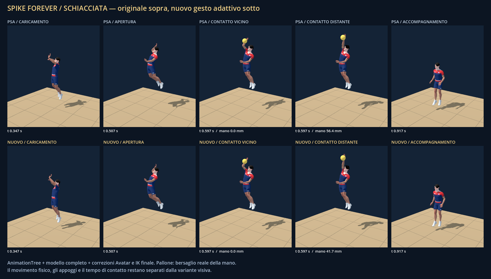
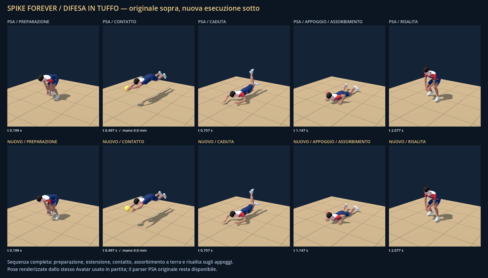

# Spike Forever 0.41.0 — Due prototipi di animazione integrati

Prima fase dell'evoluzione richiesta: un nuovo tuffo frontale completo e una schiacciata adattiva, entrambi utilizzabili in partita, convertiti in risorse native e disponibili anche con il backend PSA. Sono gesti ibridi autorati sopra gli asset esistenti, con nuove curve articolari e ritmi; non nuove registrazioni di motion capture né semplici rinominazioni dei file.

## Cosa cambia e dove si vede

- **Tuffo frontale a una mano:** preparazione del busto, apertura del braccio libero, contatto destro, assorbimento sul gomito, appoggio del palmo e rialzata. La nuova apertura del braccio libero arriva a circa 24 cm rispetto alla fonte. Viene scelto per un recupero frontale basso e raggiungibile, quando la selezione precedente avrebbe usato `dive_v26_06`. I tuffi laterali e le palle già dietro al corpo conservano le prestazioni originali.
- **Schiacciata adattiva:** caricamento asimmetrico delle braccia, contro-rotazione del busto, colpo di polso e accompagnamento. Busto e spalla si adattano alla posizione effettiva della palla prima dell'IK già esistente. La correzione è limitata a piccoli angoli e a 14 cm massimi di spostamento della mano, senza allungare gli arti. È usata quando il gioco seleziona la fonte `attack_line` su una palla buona, attualmente soprattutto in pipe; altri attacchi e pallonetti conservano le loro clip.

La selezione sostituisce **solo la propria fonte corrispondente**: tempo di contatto, offset, durata, recupero e movimento fisico restano identici. Non cambia il destinatario dell'alzata, non consuma numeri casuali del gameplay e non altera la traiettoria della palla per adattarla al gesto.

Le transizioni esistenti, il blending locale per gruppi di ossa, le correzioni dei piedi, lo sguardo e l'IK delle mani restano attivi. Il personaggio continua a muoversi attraverso il controller del gioco. Il rig privato di AnimationTree valuta le clip; soltanto `Avatar.apply_pose` scrive lo scheletro visibile dopo i correttivi.

## Confronto e prove in Godot

1. Aprire `project.godot` con Godot 4.5.1 e avviare il progetto. In partita **F7** abilita/disabilita i nuovi gesti dalla prossima azione: il gesto già iniziato termina senza essere sostituito a metà del contatto.
2. **F6** alterna AnimationTree e campionamento PSA. Le nuove curve funzionano in entrambi i backend. Per avviare direttamente con tutte le selezioni originali usare `--motion-original`; per il backend PSA usare anche `--psa-original`.
3. Per un confronto riproducibile delle fasi e del contatto eseguire, dalla cartella del progetto:

```powershell
& tools/godot/Godot_v4.5.1-stable_win64.exe --path . --script tools/Capture-Animation41.gd
```

La prova mostra il modello completo, AnimationTree e l'IK finale; salva le due tavole seguenti e poi si chiude:

Per vedere i gesti in movimento, aprire il [video di confronto di 12 secondi](animation41-preview.mp4), oppure avviare la vista interattiva:

```powershell
& tools/godot/Godot_v4.5.1-stable_win64.exe --path . --script tools/Preview-Motion41.gd
```

Nella vista interattiva **F1** passa tra attacco vicino, distante e tuffo; **Spazio** mette in pausa. Entrambi i lati applicano lo stesso movimento della radice estratto dalla fonte. Il video è una registrazione a passo fisso per valutare i gesti, non una misura degli FPS.





Per rigenerare soltanto le due risorse native, senza riconvertire il catalogo originale:

```powershell
& tools/godot/Godot_v4.5.1-stable_win64_console.exe --headless --path . --script tools/Build-Motion41.gd --quit-after 900
```

Il supplemento `assets/active/native_motion41.res` pesa 536.756 byte. I canali compatibili con PSA sono preparati una volta all'avvio e condivisi; non vengono creati nuovi file o nuove clip durante l'applicazione delle pose. I 134 PSA originali e `native_all.res` sono conservati, con hash verificati contro la release 0.40.0.

## Verifiche

- Audit degli autori: 361 campioni del tuffo e 481 della schiacciata; appoggi, lunghezze degli arti e mano al contatto preservati. Il palmo in appoggio sul parquet resta vincolato.
- `Test-Motion41.gd`: 182 campioni del supplemento, differenza nativo/PSA massima circa 0,0014 mm; conservazione delle lunghezze ai keyframe; dodici contatti reali nei due backend; recupero accodato e rialzata che rilascia il giocatore; selezione in dodici costruzioni reali nelle sei rotazioni dei due lati.
- Cattura integrata con venti pose: nel caso distante documentato, distanza mano/bersaglio da 56,4 a 41,7 mm; nessun aumento delle tolleranze di contatto.
- [Parità del gameplay](ANIMATION_GAMEPLAY_PARITY_41.md): 96 costruzioni e 26.237 confronti tra due partite con stessi comandi e semi; 24 contatti della nuova schiacciata e due tuffi completi. Differenza misurata della palla e delle radici dei giocatori pari a 0,0; stessi destinatari, tempi, rotazioni e stato RNG.
- Regressioni: 96 costruzioni ricezione–alzata–attacco, 144 casi della pipeline del palleggiatore, 192 sequenze di alzata, 20 secondi tocchi con traffico, 288 piani di copertura più 24 movimenti, controllo del muro, potenze e contatti vincenti, confronto nativo/PSA.
- Controllo di ambito: 188 file originali invariati, comprendenti PSA/PSK, libreria nativa originale, fisica della palla, tattiche, regole, timing, PlayStyle e configurazione dei comandi.

Comandi principali:

```powershell
powershell -NoProfile -ExecutionPolicy Bypass -File tools/Check-Motion41Scope.ps1
& tools/godot/Godot_v4.5.1-stable_win64_console.exe --headless --path . --script tools/Test-Motion41.gd --quit-after 900
& tools/godot/Godot_v4.5.1-stable_win64_console.exe --headless --path . --script tools/Test-Approach40.gd --quit-after 1800
```

## Prestazioni e limiti

La [ricognizione iniziale](ANIMATION_AUDIT_41.md) e il [confronto delle prestazioni](ANIMATION_PERFORMANCE_41.md) conservano misure e hash prima delle modifiche. Nello stesso carico CPU con dodici avatar e contesto di contatto, originali 6,199 ms medi e due prototipi 6,412 ms: **+0,213 ms complessivi**, con circa 4,27 MB aggiuntivi nella scena nativa. Il percorso originale senza le nuove varianti misura 5,595 → 5,606 ms. Nessuna crescita del numero di oggetti o risorse dopo il riscaldamento nei campioni raccolti.

Sono misure **CPU headless**, non FPS o tempo GPU della partita. Gli array temporanei delle pose esistono ancora. Il benchmark non dimostra assenza di allocazioni temporanee, né sostituisce una prova prolungata su tutte le configurazioni hardware.

È stato eseguito anche un confronto renderizzato con arena e dodici giocatori su RTX 5080, Forward+, 1280×720 e limite 60 FPS: **59,804 FPS originali → 59,600 FPS nuovi**, su 600 frame per caso. Il nuovo attacco è visibile in 162 frame misurati e completa tre contatti reali. Il p95 passa da 21,194 a 22,380 ms e il p99 da 24,012 a 25,525 ms; nessun frame supera 50 ms. Il costo aggiuntivo è piccolo, ma le code dei tempi aumentano: non viene dichiarata parità assoluta delle prestazioni. Dettagli e comando sono nel resoconto prestazioni.

Questa release valida due prototipi; non aggiunge ancora nuovi tuffi laterali, nuovi palleggi in movimento o un intero catalogo di attacchi. Le correzioni restano volutamente limitate: una palla fuori portata non viene raggiunta deformando il corpo. I residui di scivolamento propri delle clip originali e del movimento corrente non sono dichiarati eliminati su tutto il catalogo. Il primo passaggio da PSA a AnimationTree con F6 può inizializzare il rig nativo: è una modalità di confronto, non un comando del gameplay.

## File coinvolti

| File | Intervento |
| --- | --- |
| `src/dive_motion41.gd` | Curve autorate e fasi del tuffo |
| `src/attack_motion41.gd` | Gesto di attacco e adattamento limitato alla palla |
| `src/motion_prototypes.gd` | Generazione iniziale dei due canali PSA compatibili, supplemento nativo e scelta contestuale |
| `src/avatar.gd` | Riconoscimento dei due clip nativi e adattamento prima dell'IK finale |
| `src/pose_animation_tree.gd` | Unione immutabile del catalogo originale con due animazioni supplementari |
| `src/main.gd` | Registrazione iniziale, selezione delle due prestazioni, confronto F7 |
| `assets/active/native_motion41.res` | Due animazioni native precalcolate |
| `tools/Build-Motion41.gd`, `Test-Motion41.gd`, `Test-MotionGameplay41.gd`, `Check-Motion41Scope.ps1` | Conversione e verifiche |
| `tools/Audit-Animation41.gd`, `Audit-Dive41.gd`, `Audit-Attack41.gd`, `Capture-Animation41.gd`, `Benchmark-Animation41.gd`, `Benchmark-AnimationPrototypes41.gd` | Audit, confronto visivo e misure ripetibili |
| `tools/Preview-Motion41.gd`, `docs/animation41-preview.mp4` | Confronto animato riproducibile |
| `tools/Benchmark-RenderedMotion41.gd` | Confronto del frame rate con partita e attacco effettivamente renderizzati |
| README, versione, documentazione e strumenti di pubblicazione | Release e risultati verificabili |

Il parser `psa.gd` non è stato riscritto o eliminato. Nessuna dipendenza obbligatoria da Blender.
